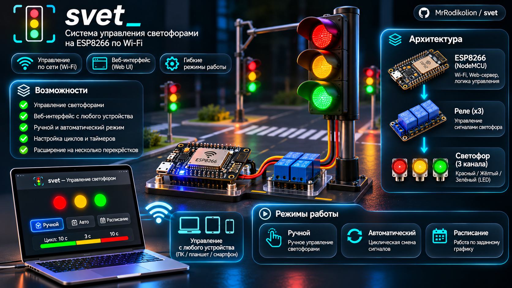
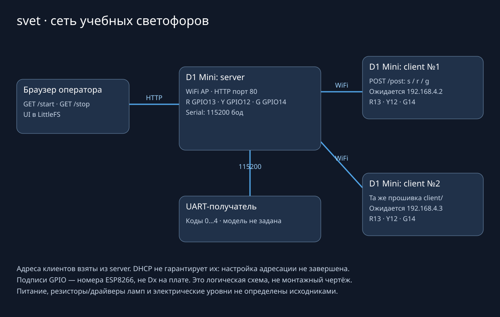

# svet



*Концептуальная иллюстрация: изображение не является точной схемой или подтверждением аппаратной реализации.*

**Учебная сеть светофоров на ESP8266 с браузерным управлением и UART-кодами состояния.**

Один D1 Mini создаёт WiFi-сеть и обслуживает интерфейс из LittleFS. Два клиента
получают однобайтные HTTP-команды, управляют световыми выходами и передают состояние
в UART. Проект остаётся стендовым прототипом: согласованность физических светофоров
при потере сети не подтверждена.



## Состав репозитория

| Каталог | Назначение | Плата |
|---|---|---|
| `server/` | WiFi AP, веб-интерфейс, отправка команд двум клиентам, локальные выходы | ESP8266 D1 Mini |
| `client/` | Приём команд и цикл светофора | ESP8266 D1 Mini |
| `trys/` | Экспериментальная отправка UART-байтов 0, 1, 2 | ESP8266 D1 Mini |
| `ardtest/` | Приём Serial3, печать в Serial и LED-индикатор | Arduino Mega 2560 |

Структура отдельных PlatformIO-проектов сохранена. Экспериментальные каталоги
не являются дополнительными функциями основной серверной прошивки.

## Подключения

На server и client используются одинаковые номера GPIO ESP8266:

| Выход | GPIO |
|---|---|
| Красный | 13 |
| Жёлтый | 12 |
| Зелёный | 14 |
| UART | Serial, 115200 бод; отдельные пины кодом не задаются |

Это номера GPIO, не обозначения `D0…D8` на корпусе платы. Схема показывает
логические связи; питание, драйверы ламп, резисторы и UART-уровни исходниками
не определены. Они должны быть проверены по реальным устройствам.

Сервер отправляет команды на `192.168.4.2/post` и `192.168.4.3/post`.
**Назначение этих адресов клиентам не завершено:** `WiFi.config` закомментирован,
а объявленный `local_IP` не используется. DHCP может выдать другие адреса.
Схема подписывает ожидаемые сервером адреса, не выдавая их за проверенную сеть.
Существующие WiFi-учётные данные при доработке не изменялись и здесь не приводятся.

## Управление и протокол

| HTTP endpoint | Действие |
|---|---|
| `GET /` на server | Веб-интерфейс из LittleFS |
| `GET /stop` | Локальный красный; команда `s` обоим клиентам |
| `GET /start` | Локальный зелёный; `r` первому и `g` второму клиенту |
| `GET /svet0` | Поле `clr` из существующего массива; не универсальная телеметрия всех устройств |
| `POST /post` на client | Один байт `s`, `r` или `g` |

Клиент отвергает пустые, длинные и недопустимые тела с HTTP 400; успешная команда
подтверждается HTTP 200. Команда не является JSON или строкой с переводом строки.
Повтор того же байта подтверждается без перезапуска текущей фазы.

Сервер считает обновление доставленным только после двух ответов 2xx. При сбое
повторяет отправку с интервалом не меньше секунды; отдельный HTTP-запрос ограничен
таймаутом в секунду. Это подтверждение получения команд, а не синхронизация времени
между платами и не гарантия безопасной работы физического перекрёстка.

UART сервера выдаёт `0x00` при остановке и `0x02` при разрешении движения.
UART клиента выдаёт бинарные состояния:

| Байт | Цвет | Номинальная длительность |
|---|---|---|
| `0x00` | Красный | 5 с |
| `0x01` | Красный + жёлтый | 2 с |
| `0x02` | Зелёный | 7 с |
| `0x03` | Мигающий зелёный | 2 с |
| `0x04` | Жёлтый | 3 с |

## Сборка

Нужен PlatformIO Core. Сборка не загружает код на устройства:

```sh
git clone https://github.com/MrRodikolion/svet.git
cd svet
pio run --project-dir server
pio run --project-dir client
pio run --project-dir trys
pio run --project-dir ardtest
```

Данные веб-интерфейса находятся в `server/data/`. Образ LittleFS можно собрать
без прошивки платы:

```sh
pio run --project-dir server --target buildfs
```

Порты COM3/COM4 в существующих конфигурациях относятся к авторской среде; для
загрузки потребуется выбрать собственные устройства. Загрузка прошивки и LittleFS
в этом проходе не выполнялась.

## Проверки и ограничения

Внешние регрессии проверяют допустимые/неполные HTTP-тела, повтор команды,
обработку 2xx/ошибок, повторную отправку и смену команды во время передачи.
Аппаратные функции подменяются; сеть реальных плат и лампы не включались.
Фактические функции из исходников прошли 14 host C++-проверок.
Сборка `ardtest` для Mega2560 прошла: RAM 345 байт, Flash 3014 байт.
Основные ESP8266-сборки `server`, `client`, `trys` **не подтверждены**:
установка отсутствующих toolchains ожидала завершения общей загрузки и была
остановлена по лимиту времени. Сборка LittleFS также не проверена.

`test/README` — шаблоны PlatformIO, собственного постоянного набора тестов нет.
Не проверены распределённая синхронизация фаз, длительные сетевые разрывы,
выходы при перезапуске и поведение после утраты управляющего сервера.

## Roadmap

- [ ] Согласовать адресацию двух клиентов с серверными URL.
- [ ] Проверить электрическую схему и силовые драйверы на стенде.
- [ ] Добавить heartbeat и явно определённый безопасный режим потери связи.
- [ ] Проверить восстановление и синхронизацию после сброса любого узла.
- [ ] Согласовать веб-таймер с реальным временем и состояниями устройств.
- [ ] Добавить постоянные тесты протокола и обработку состояния каждого клиента.
